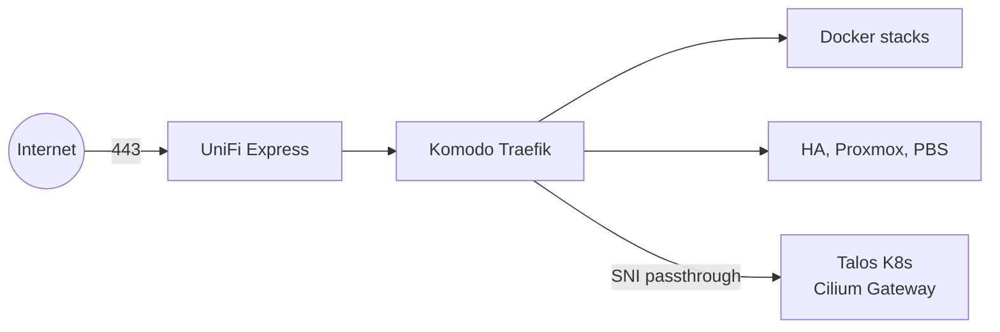

# HomeLab Project 🏠💻

My homelab as code: a single Proxmox node running a Talos Kubernetes cluster, a Komodo-managed Docker host and a
handful of LXCs and VMs, all published under `*.ravil.space` through one Traefik.

Docs: [architecture snapshot](docs/architecture/00-homelab-architecture.md) · [docs index](docs/README.md) ·
[bootstrap](docs/runbooks/bootstrap.md) · [troubleshooting](docs/runbooks/troubleshooting.md)



---

## Core Technologies 🛠️
- [Proxmox VE](https://www.proxmox.com/) and [Proxmox Backup Server](https://www.proxmox.com/en/proxmox-backup-server) — virtualization and backups.
- [Terraform](https://www.terraform.io/) — Talos VMs, LXCs, Proxmox CSI and sealed-secrets (state in Terraform Cloud, CI plan/apply).
- [Talos Linux](https://www.talos.dev/) — Kubernetes OS.
- [Cilium](https://cilium.io/) — CNI, L2 load balancer and [Gateway API](https://gateway-api.sigs.k8s.io/) implementation.
- [ArgoCD](https://argo-cd.readthedocs.io/) — GitOps for everything under `k8s/`.
- [Cert-Manager](https://cert-manager.io/) — certificates for the K8s gateway.
- [Proxmox CSI](https://github.com/sergelogvinov/proxmox-csi-plugin) — persistent volumes.
- [Sealed Secrets](https://github.com/bitnami-labs/sealed-secrets) — encrypted secrets that are safe to store in Git.
- [Komodo](https://komo.do/) — Docker Compose stacks from `komodo/stacks/`, declared in `komodo/stacks.toml`.
- [Traefik](https://traefik.io/) — the single public entry point (Komodo stack): HTTP routing plus TLS passthrough to K8s.
- [CrowdSec](https://www.crowdsec.net/) — bans scanners from Traefik's access log (bouncer plugin on every route).
- [PocketID](https://github.com/pocket-id/pocket-id) — OIDC provider for Traefik forward auth, oauth2-proxy and native SSO.
- [Pi-hole](https://pi-hole.net/) — LAN DNS, ad blocking and split DNS for `*.ravil.space`.
- [Grafana LGTM](https://grafana.com/) — self-hosted logs, metrics and traces (Komodo stack).

---

## Applications 📦

### Docker stacks — Komodo (`komodo/stacks/`)
- [Glance](https://github.com/glanceapp/glance) — personal dashboard.
- [Dozzle](https://dozzle.dev/) — Docker log viewer.
- [IT Tools](https://github.com/CorentinTh/it-tools) — IT utility toolbox.
- [iSponsorBlockTV](https://github.com/dmunozv04/iSponsorBlockTV) — SponsorBlock for YouTube on TVs.
- [cloudflare-ddns](https://github.com/timothymiller/cloudflare-ddns) — keeps `*.ravil.space` on the dynamic public IP.
- [Immich](https://immich.app/) — photos.
- [Paperless-ngx](https://docs.paperless-ngx.com/) and [Paperless-GPT](https://github.com/icereed/paperless-gpt) — documents with OCR and LLM tagging.
- [Audiobookshelf](https://www.audiobookshelf.org/) — audiobooks.
- [AudioBookRequest](https://github.com/markbeep/AudioBookRequest), [Prowlarr](https://prowlarr.com/) with [FlareSolverr](https://github.com/FlareSolverr/FlareSolverr), [qBittorrent](https://www.qbittorrent.org/) over [Xray](https://github.com/XTLS/Xray-core) VLESS — audiobook requests and downloads.
- [n8n](https://n8n.io/) — workflow automation.
- [Miniflux](https://miniflux.app/), [Nextflux](https://github.com/electh/nextflux), [RSSHub](https://rsshub.app/) — RSS.
- [Karakeep](https://karakeep.app/) — bookmarks and read-it-later.
- [ByteStash](https://github.com/jordan-dalby/ByteStash) — code snippets.
- [Your Spotify](https://github.com/Yooooomi/your_spotify) — Spotify listening stats.
- [Mattermost](https://mattermost.com/) — team chat.
- [OpenHands](https://github.com/All-Hands-AI/OpenHands) — AI coding environment.
- [LLM Council](https://github.com/karpathy/llm-council) — multi-model OpenRouter web app.
- [Change Detection](https://changedetection.io/) — website change monitoring.
- [Free Games Claimer](https://github.com/vogler/free-games-claimer) — claims free Epic/GOG games.
- [Ntfy](https://ntfy.sh/) — push notifications.
- [Umami](https://umami.is/) — web analytics.
- [Dozzle](https://dozzle.dev/) — Docker log viewer.
- HA wall panel, guest door access, Honcho (LAN-only memory API) — small custom apps.
- Platform: Traefik, PocketID, Grafana LGTM, GitHub Actions runner.

### Proxmox guests (routed by the Komodo Traefik file provider)
- [Home Assistant OS](https://www.home-assistant.io/) — VM 105.
- Proxmox VE and Proxmox Backup Server web UIs.

---

## Repository Structure 📂

```shell
.
├── docs                  # architecture snapshot, runbooks, ADRs
├── k8s
│   ├── apps/internal     # one directory per app, synced by the internal-apps ApplicationSet (empty now)
│   ├── components        # reusable kustomize components (auth-middleware)
│   ├── examples          # reference manifests, not deployed
│   └── infra
│       ├── argocd        # ArgoCD and its Applications
│       ├── crds          # Gateway API CRDs
│       ├── network       # cilium, gateway, coredns
│       ├── security      # cert-manager, sealed-secrets
│       └── storage       # proxmox-csi
├── komodo
│   ├── stacks            # docker compose stacks
│   ├── stacks.toml       # Komodo stack declarations (resource sync)
│   └── sync.toml         # the resource sync itself
└── terraform
    ├── lxc.tf            # LXC containers from var.lxc
    └── modules
        ├── proxmox             # Talos VMs
        ├── proxmox-csi-plugin  # Proxmox storage for k8s
        ├── sealed-secrets      # sealed-secrets controller + key
        └── talos               # Talos cluster
```

## Deployment 🚢

- **Kubernetes:** merge to `main`; ArgoCD auto-syncs `k8s/infra/*` and `k8s/apps/internal/*` (https://argocd.ravil.space).
- **Docker stacks:** merge to `main`; the `Komodo Deploy` workflow runs the resource sync and deploys changed stacks one at a time.
  `vova-medcenter` is the exception: it lives on the `deploy/vova-medcenter` branch and the `vova-medcenter Deploy`
  workflow deploys it when the live revision falls behind that branch.
- **Terraform:** the `Terraform` workflow plans on PRs and applies on `main` (self-hosted runner).
- **From scratch:** `make bootstrap` (see the [bootstrap runbook](docs/runbooks/bootstrap.md)).

```bash
make argocd-password   # ArgoCD admin password
make argocd-restart    # restart ArgoCD
make kubeconfig        # kubeconfig from Terraform output
```
