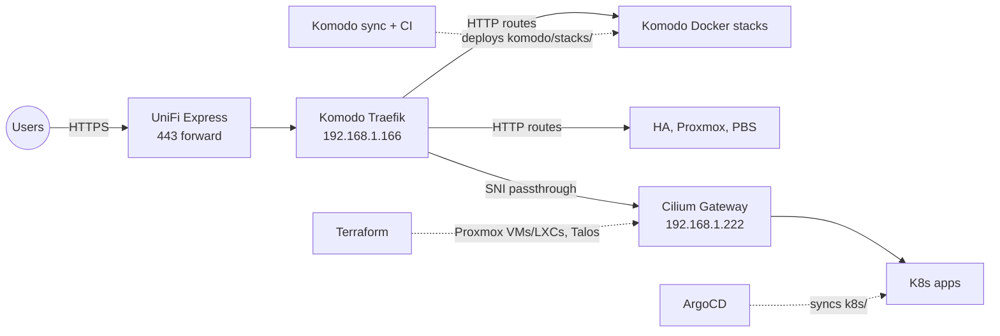

# HomeLab Documentation

- [Homelab Architecture Snapshot](architecture/00-homelab-architecture.md) — network, ingress, Proxmox, Kubernetes,
  Komodo, identity, storage, observability and deployment flows. Start here.
- [Network Diagram](diagrams/network/homelab-network.html) — standalone rendered topology (open the file in a browser)
- [Bootstrap](runbooks/bootstrap.md) — rebuild the Talos cluster from scratch
- [Troubleshooting](runbooks/troubleshooting.md) — where to look when something is down
- [ADRs](adr/README.md) — recorded architecture decisions

## Architecture at a glance

## Keeping docs current

- Change docs in the same PR as the code they describe.
- The architecture snapshot lists its live sources ("Operational source of truth"); refresh it from there.
- Diagrams are Mermaid and render on GitHub. Use ` ` for line breaks in labels, never `\n`.
