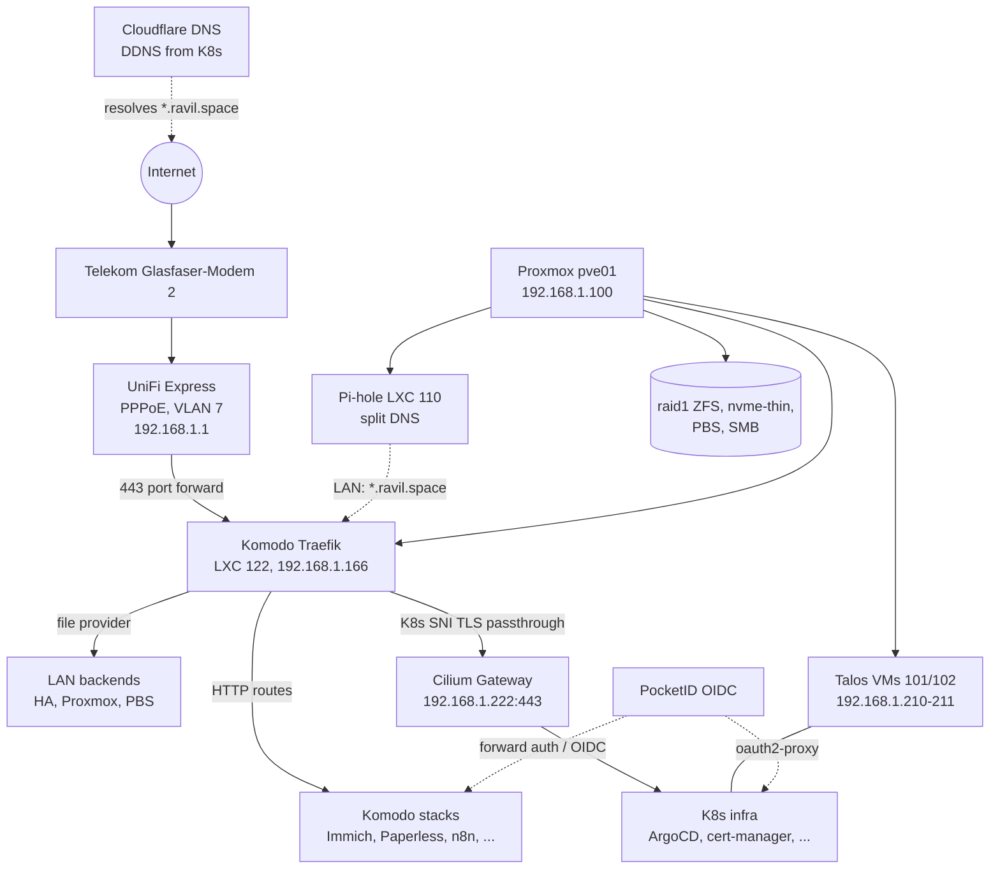

# Homelab Architecture Snapshot

This document is the current end-to-end view of Ravil's homelab: network edge, Proxmox, Kubernetes, Komodo/Docker, ingress, storage, observability, and operational flows.

It combines infrastructure-as-code from this repository with a point-in-time live discovery of UniFi, Proxmox, Kubernetes, and the Komodo Docker host.

## Snapshot metadata

- **Snapshot date:** 2026-10-25
- **Primary domain:** `ravil.space`
- **Home network:** UniFi-managed LAN behind a UniFi Express gateway
- **Virtualization:** Proxmox VE cluster `cluster01`
- **Kubernetes:** Talos sandbox cluster on Proxmox VMs, **parked** since 2026-10-25 (`k8s_enabled = false`, VMs 101/102 destroyed;
  code kept, see [bootstrap](../runbooks/bootstrap.md) to bring it back). Sections below describe it when enabled
- **Docker platform:** Komodo-managed Docker Compose host
- **IaC sources:** `terraform/`, `k8s/`, `komodo/stacks/`, `komodo/stacks.toml`
- **Live sources used:** UniFi API, Proxmox API, Kubernetes API, Docker on `komodo`

Exact IP addresses and service inventories below are operationally useful, but they are still a snapshot. Treat the repository as the source of truth for desired state and live APIs as the source of truth for current state.

## Topology diagram

- Standalone rendered diagram: [`../diagrams/network/homelab-network.html`](../diagrams/network/homelab-network.html)
- Mermaid source is included below for GitHub rendering.

## Network and edge

### UniFi gateway

- **Gateway:** UniFi Express (`UX`)
- **Hostname:** `UniFi-Express`
- **Firmware:** `4.0.15`
- **Network app:** `9.0.118`
- **ISP:** Deutsche Telekom AG
- **Timezone:** Europe/Berlin
- **WAN:** PPPoE directly to Telekom FTTH (VLAN 7, MTU 1492) via the Telekom Glasfaser-Modem 2; no Speedport, no double NAT.
  Public IPv4 is dynamic, the Komodo `cloudflare-ddns` stack keeps `*.ravil.space` pointed at it. IPv6 disabled.
- **LAN IP on gateway:** `192.168.1.1`
- **Configuration counts:**
  - LAN configurations: 3
  - WAN configurations: 1
  - Wi-Fi configurations: 4
  - Gateway devices: 1
  - Total UniFi devices: 1
- **Clients observed:**
  - Wi-Fi clients: 12
  - Wired clients: 8
  - Guest clients: 0
- **Health observed:**
  - WAN uptime: 100%
  - Offline devices: 0
  - Offline gateway/wired/Wi-Fi devices: 0
  - Critical notifications: 0
- **Threat inspection:** inspection off, IDS/IPS disabled

### LAN roles

- `192.168.1.1` — UniFi Express gateway
- `192.168.1.2` — `fileserver` LXC
- `192.168.1.3` — Pi-hole LXC
- `192.168.1.100` — Proxmox node `pve01`
- `192.168.1.166` — Komodo Docker host LXC
- `192.168.1.210` — Talos control-plane node observed from Kubernetes pods
- `192.168.1.211` — Talos worker node observed from Kubernetes pods
- `192.168.1.221` — Kubernetes `tls-passthrough` Gateway
- `192.168.1.222` — Kubernetes `external` Gateway, HTTPS target used by the Komodo Traefik passthrough

### DNS and public access

The public namespace is `*.ravil.space`.

- Cloudflare DNS points public service names at the homelab edge.
- The Komodo `cloudflare-ddns` stack keeps the `*.ravil.space` A record aligned with WAN changes.
- Pi-hole exists as a Proxmox LXC for LAN DNS/ad-blocking.
- Split DNS: Pi-hole answers `*.ravil.space` with `192.168.1.166` (`misc.dnsmasq_lines = ["address=/*.ravil.space/192.168.1.166"]`),
  so LAN clients reach the Komodo Traefik directly (K8s hostnames included, via the SNI passthrough) instead of hairpinning
  through the router. The apex `ravil.space` and its MX still resolve publicly; AAAA and TXT for subdomains return empty.
- Local names (`.lan`): static hosts (pve01, komodo, pbs, homeassistant, talos-*, ...) are `dns.hosts` entries in Pi-hole
  (`expandHosts` adds `.lan`); everything else, plus reverse lookups for `192.168.1.0/24`, is conditionally forwarded to
  UniFi (`dns.revServers = ["true,192.168.1.0/24,192.168.1.1,lan"]`), which knows DHCP client hostnames.
- External HTTPS (port 443, forwarded by the router) enters the homelab at the Komodo Traefik on `192.168.1.166`.

## Ingress and TLS routing

A single Traefik (the Komodo `traefik` stack) receives all external HTTPS. The router forwards `443/tcp` to `192.168.1.166`.
Until 2026-10 a separate edge Traefik LXC (`108`) did SNI passthrough in front of it; it was removed.

### Kubernetes hostnames (TLS passthrough)

`komodo/stacks/traefik/dynamic/external.yml` has a `tcp:` router `k8s` that matches the Kubernetes-served hostnames by
`HostSNI` and passes the TLS connection through, untouched, to the Cilium gateway at `192.168.1.222:443`
(cert-manager certificates). TCP routers are matched before the HTTP routers, so every other hostname is handled by
the HTTP routes below.

Kubernetes SNI hostnames currently routed:

- `argocd.ravil.space`

Operational rule:

- Add a new Kubernetes-served hostname to the `k8s` TCP router in `komodo/stacks/traefik/dynamic/external.yml`.
- Add a new Komodo-served hostname only to the stack labels.

### Komodo Traefik container

- **Host:** Komodo LXC `122`, `192.168.1.166`
- **Stack source:** `komodo/stacks/traefik/compose.yaml`
- **Role:** the only public entry point: HTTP reverse proxy for Docker Compose stacks and LAN backends, TLS passthrough for K8s
- **TLS:** Cloudflare resolver configured in the stack
- **Auth:** OIDC forward-auth middleware backed by PocketID for protected public apps
- **Blocking:** CrowdSec (in the same stack) reads Traefik's access log from Docker and bans scanners; the
  `crowdsec@docker` bouncer middleware runs first on every `websecure` route and returns 403 for banned IPs
  (local decisions + community blocklist). It fails open, and LAN/Docker ranges are never banned.
  Bouncer key: Komodo secret `CROWDSEC_BOUNCER_KEY`. Inspect with `docker exec crowdsec cscli decisions list` / `cscli alerts list`

### Kubernetes Gateway API

- **Gateway manifests:** `k8s/infra/network/gateway/`
- **Gateway target used by Komodo Traefik passthrough:** `192.168.1.222:443`
- **CNI/LB:** Cilium with Gateway API support
- **TLS:** cert-manager manages certificates; wildcard cert resources live under gateway manifests

## Proxmox platform

### Cluster

- **Cluster:** `cluster01`
- **Quorum:** yes
- **Node count:** 1
- **Node:** `pve01`
- **Node IP:** `192.168.1.100`
- **Node status:** online
- **Capacity observed:**
  - CPU: 6 cores
  - RAM: about 32 GiB

### Guests

Running VMs:

- `101` — `talos-cp-01`, Talos Kubernetes control-plane, Terraform-managed (absent while parked)
- `102` — `talos-worker-01`, Talos Kubernetes worker, Terraform-managed (absent while parked)
- `105` — `haos12.4`, Home Assistant OS

Running LXCs:

- `103` — `proxmox-backup-server`, backup service
- `104` — `pocketid`, stopped; migrated to the Komodo `pocketid` stack
- `106` — `changedetection`, stopped; migrated to the Komodo `changedetection` stack
- `110` — `pihole`, LAN DNS/ad-blocking
- `112` — `prometheus-pve-exporter`, Proxmox metrics exporter
- `114` — `hermes`, Hermes Agent host/services
- `117` — `fileserver`, LAN file services
- `122` — `komodo`, Docker/Komodo host at `192.168.1.166`
- `125` — `vless-gateway`, sing-box/VLESS gateway

Terraform manages the LXCs in `var.lxc` (`terraform/homelab.auto.tfvars`): 103, 110, 112, 117, 122.
`hermes` (114) and `vless-gateway` (125) are intentionally unmanaged.

### Storage

- `raid1`
  - Type: ZFS pool
  - Capacity observed: about 11.85 TB
  - Content: VM images and container root filesystems
- `nvme-thin`
  - Type: LVM-thin
  - Capacity observed: about 980 GB
  - Content: VM images and container root filesystems
- `local`
  - Type: directory
  - Content: backups, templates, snippets, ISOs
- `local-lvm`
  - Type: LVM-thin
  - Content: VM images and container root filesystems
- `pbs-s3-blackbaze`
  - Type: Proxmox Backup Server storage
  - Content: backups
- `smb`
  - Type: CIFS
  - Capacity observed: about 1 TB
  - Content: backups and images

## Kubernetes platform

### Cluster shape

- **OS:** Talos Linux v1.11, Kubernetes v1.34
- **Control plane:** `talos-cp-01`, observed at `192.168.1.210`
- **Worker:** `talos-worker-01`, observed at `192.168.1.211`
- **IaC source:** Terraform modules `terraform/modules/{proxmox,talos}/`, gated by `var.k8s_enabled`
- **Manifests:** `k8s/`
- **GitOps:** ArgoCD. `k8s/infra/argocd/applications/infrastructure.yaml` syncs crds, cilium, cert-manager, gateway and ddns;
  the `internal-apps` ApplicationSet syncs every directory in `k8s/apps/internal/`. Proxmox CSI and sealed-secrets are
  installed by Terraform (Helm).

### Core infrastructure namespaces

- `argocd` — GitOps controller and UI
- `cert-manager` — certificate automation
- `cilium-secrets` and `kube-system` — Cilium/eBPF networking and Hubble
- `csi-proxmox` — Proxmox CSI controller and node plugin
- `gateway` — Gateway API resources
- `sealed-secrets` — encrypted Kubernetes secrets controller
- `kubelet-serving-cert-approver` — approves kubelet serving certificates (Talos)

### Kubernetes app inventory

`k8s/apps/internal/` is empty: the last apps (Glance, IT Tools, iSponsorBlockTV) moved to Komodo stacks in 2026-10,
Inbox Zero and the Kubernetes Dozzle were removed. The cluster only runs its own infrastructure and ArgoCD.

Home Assistant (`ha.ravil.space`) is routed by Komodo's Traefik (`traefik/dynamic/external.yml`), PocketID (`pocketid.ravil.space`) by the Komodo `pocketid` stack, Grafana (`grafana.ravil.space`) by the Komodo `grafana-lgtm` stack, and Change Detection (`changedetection.ravil.space`) by the Komodo `changedetection` stack, not Kubernetes.

## Komodo and Docker platform

### Host

- **Proxmox guest:** LXC `122`, name `komodo`
- **LAN IP:** `192.168.1.166`
- **Role:** Docker Compose stack host and Komodo control plane/periphery
- **Stack definitions:** `komodo/stacks/<stack>/compose.yaml`
- **Komodo inventory:** `komodo/stacks.toml`

### Routing model

- The router forwards `443/tcp` straight to `192.168.1.166`.
- The Docker Traefik container terminates TLS and routes by Docker labels.
- Most public apps are protected either by Traefik OIDC middleware or by their native auth.

### Docker stack inventory

Application stacks:

- `audiobookshelf` — audiobook server at `audiobooks.ravil.space` (native OIDC)
- `bytestash` — snippet manager at `bytestash.ravil.space`
- `changedetection` — website change monitoring at `changedetection.ravil.space` (migrated from LXC 106)
- `cloudflare-ddns` — keeps `*.ravil.space` on the dynamic public IPv4 (reuses the Traefik ACME token `CF_DNS_API_TOKEN`)
- `dozzle` — Docker log viewer at `dozzle.ravil.space`
- `glance` — personal dashboard at `glance.ravil.space`
- `free-games-claimer` — free games claimer noVNC UI at `fgc.ravil.space`
- `guest-door-access` — guest door access app at `guest-access.ravil.space` (currently scaled to 0)
- `ha-wall-panel` — Home Assistant wall panel at `ha-dashboard.ravil.space`
- `isponsorblocktv` — SponsorBlock for YouTube on TVs, no hostname (config in `komodo/stacks/isponsorblocktv/config.json`)
- `it-tools` — utility toolbox at `it-tools.ravil.space`
- `immich` — photo management at `immich.ravil.space`
- `karakeep` — bookmarks/read-it-later at `karakeep.ravil.space`
- `llm-council` — multi-model OpenRouter web app at `llm-council.ravil.space`
- `mattermost` — team messaging at `mattermost.ravil.space`
- `miniflux` — RSS reader at `miniflux.ravil.space`
- `n8n` — workflow automation at `n8n.ravil.space`
- `nextflux` — Miniflux frontend at `nextflux.ravil.space`
- `ntfy` — push notifications at `ntfy.ravil.space`
- `openhands` — AI coding environment at `openhands.ravil.space`
- `paperless-ngx` — document management at `paperless.ravil.space`
- `paperless-gpt` — AI assistant for Paperless at `paperless-gpt.ravil.space`
- `rsshub` — RSS generator at `rsshub.ravil.space`
- `umami` — web analytics at `umami.ravil.space`
- `vova-medcenter` — delegated external app at `vova-medcenter.ravil.space`; stack lives on the `deploy/vova-medcenter` branch, deployed by Komodo webhook on push
- `your_spotify` — Spotify stats at `spotify.ravil.space` and API at `spotify-server.ravil.space`

Platform/support stacks:

- `traefik` — Docker reverse proxy, OIDC middleware integration and CrowdSec (scanner bans); `traefik/dynamic/external.yml` also routes
  to non-Docker backends: Home Assistant (`ha`, → `192.168.1.153:8123`), Proxmox VE (`proxmox`, OIDC, → `192.168.1.100:8006`),
  PBS (`pbs`, OIDC, → `192.168.1.121:8007`) and
  Health Connect ingest (`health-connect`, → `192.168.1.65:9121`)
- `grafana-lgtm` — local LGTM observability stack plus cAdvisor and Docker socket proxy
- `github-runner` — ephemeral self-hosted GitHub Actions runner
- `pocketid` — PocketID OIDC provider at `pocketid.ravil.space` (migrated from LXC `104`)
- `honcho` — LAN-only memory backend API on `192.168.1.166:8077`, with PostgreSQL/pgvector and Redis
- `komodo-core`, `komodo-periphery`, `komodo-mongo` — Komodo itself, present on the Docker host

## Identity and access

### PocketID

PocketID is the central OIDC identity provider for user-facing services.

It runs as the Komodo `pocketid` stack (data in the `pocketid_data` volume) at `pocketid.ravil.space`,
and is referenced by the Traefik `oidc-auth` middleware, Komodo, Proxmox/PBS SSO and the K8s oauth2-proxy.

### Auth patterns

- **Docker/Komodo public services:** usually protected by Traefik `oidc-auth@docker` middleware unless they have acceptable native auth.
- **Kubernetes services:** use Gateway API routes and, where needed, oauth2-proxy or service-native auth.
- **Machine/API clients:** may require password/API-token auth even when the browser UI uses OIDC.

## Certificates and secrets

- **Public TLS:** Cloudflare DNS and ACME automation.
- **Kubernetes certificates:** cert-manager resources in `k8s/infra/security/cert-manager/` and Gateway cert resources in `k8s/infra/network/gateway/`.
- **Kubernetes secrets:** Sealed Secrets committed to Git as encrypted manifests.
- **Docker/Komodo secrets:** Komodo variables/secrets, referenced from Compose with `[[SECRET_NAME]]` placeholders or `.env` files next to stack compose files.
- **Terraform secrets:** passed through environment variables and Terraform Cloud/remote state mechanisms; do not commit plaintext secrets.

## Observability

### Kubernetes

- Cilium and Hubble provide network visibility.
- Metrics Server is installed by the Talos control-plane config (`extraManifests`).
- There is no in-cluster metrics/log shipping; Grafana Cloud and the Terraform `monitoring` module are gone.

### Proxmox

- `prometheus-pve-exporter` LXC exports Proxmox metrics.
- Proxmox API is available for live inventory and status checks.
- PBS and storage backends provide backup state.

### Docker/Komodo

- `grafana-lgtm` provides local Loki/Grafana/Tempo/Mimir style observability.
- `cadvisor` and `docker-socket-proxy` expose container metrics safely.
- `dozzle.ravil.space` provides Docker log viewing (Dozzle can't mix Kubernetes and Docker modes; there is no Kubernetes log viewer).
- Traefik access logs are the authoritative check for routed HTTP/TLS behavior; use them when verifying public services.

## Storage, data, and backups

### Persistent data locations

- Kubernetes PVs are provisioned by Proxmox CSI where applicable.
- Docker stacks use named Docker volumes and bind mounts defined in `komodo/stacks/<name>/compose.yaml`.
- Proxmox VMs/LXCs use `raid1`, `nvme-thin`, `local-lvm`, and related storage pools.
- Fileserver and SMB storage provide shared/backup-oriented capacity.

### Backup posture

- `proxmox-backup-server` runs as LXC `103`.
- `pbs-s3-blackbaze` is configured as PBS storage.
- `smb` storage is available for backup/image content.
- Critical app-level backups still depend on each stack's volume/database strategy; verify per stack before destructive changes.

## Deployment and GitOps flows

### Infrastructure flow

1. Terraform under `terraform/` manages Proxmox (Talos VMs and LXC containers), Talos, Proxmox CSI, and sealed-secrets bootstrap pieces.
   CI (`.github/workflows/terraform.yaml`) plans on PRs and applies on `main` from the self-hosted runner.
2. Talos nodes run Kubernetes on Proxmox VMs.
3. Kubernetes manifests under `k8s/` are reconciled by ArgoCD.
4. External/public routes are wired through Gateway API and the Komodo Traefik `k8s` SNI passthrough router.

### Kubernetes app flow

1. Add or change manifests under `k8s/apps/` or `k8s/infra/`.
2. For new public K8s hostnames, add the hostname to the `k8s` TCP router in `komodo/stacks/traefik/dynamic/external.yml`.
3. ArgoCD syncs the desired state.
4. Verify pods, routes and certificate state.

### Komodo app flow

1. Add or change `komodo/stacks/<name>/compose.yaml`.
2. Add/update the stack entry in `komodo/stacks.toml` (never `deploy = true`).
3. Keep secrets in Komodo variables/secrets or stack-local `.env` files on the host, not in Git.
4. On merge, `.github/workflows/komodo-deploy.yaml` runs the resource sync, then deploys changed stacks one by one.
5. Verify container status, app logs, HTTPS status, and Docker Traefik access logs.

### Git workflow

- Never push directly to `main`.
- Use a feature branch and pull request.
- Treat docs changes like infrastructure changes: keep them reviewable and close to the code they describe.

## Operational source of truth

Use these sources when refreshing this document:

- **UniFi/router:** UniFi API using `UNIFI_API_KEY`; start with `/ea/hosts` and `/ea/sites`.
- **Proxmox:** Proxmox API or `terraform/modules/proxmox/` and `terraform/modules/talos/`.
- **Kubernetes live:** `kubectl get nodes,pods,svc,httproutes,tlsroutes -A` and ArgoCD applications.
- **Kubernetes desired state:** `k8s/infra/` and `k8s/apps/`.
- **Edge routing:** `komodo/stacks/traefik/dynamic/external.yml`.
- **Docker desired state:** `komodo/stacks/` and `komodo/stacks.toml`.
- **Docker live state:** `ssh 192.168.1.166 'docker ps'` and Traefik logs.
- **Service verification:** always check Traefik access logs, not only `curl` HTTP status.

## Known architecture notes

- Kubernetes terminates TLS itself, so its hostnames are TLS-passthrough TCP routes in the Komodo Traefik and must be listed explicitly; everything else is an HTTP route there.
- If a hostname appears in both Kubernetes and Komodo definitions, the TCP (passthrough) route wins; confirm with the Traefik dashboard before changing it.
- IDS/IPS is currently disabled on the UniFi gateway; security is primarily service auth, TLS, segmentation by host/platform, and GitOps/IaC discipline.
